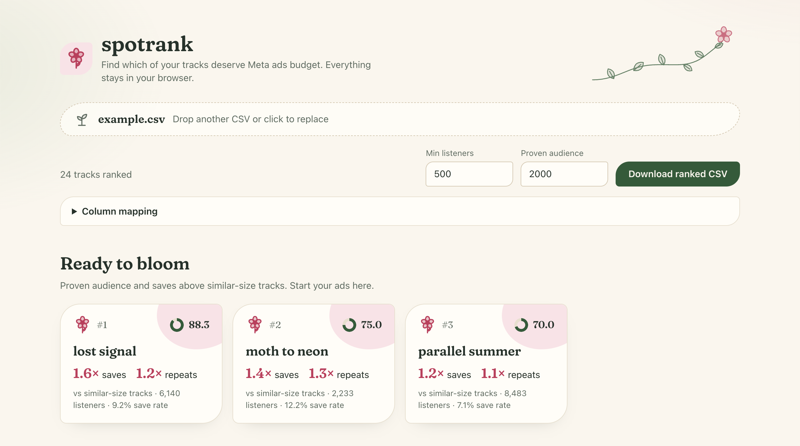
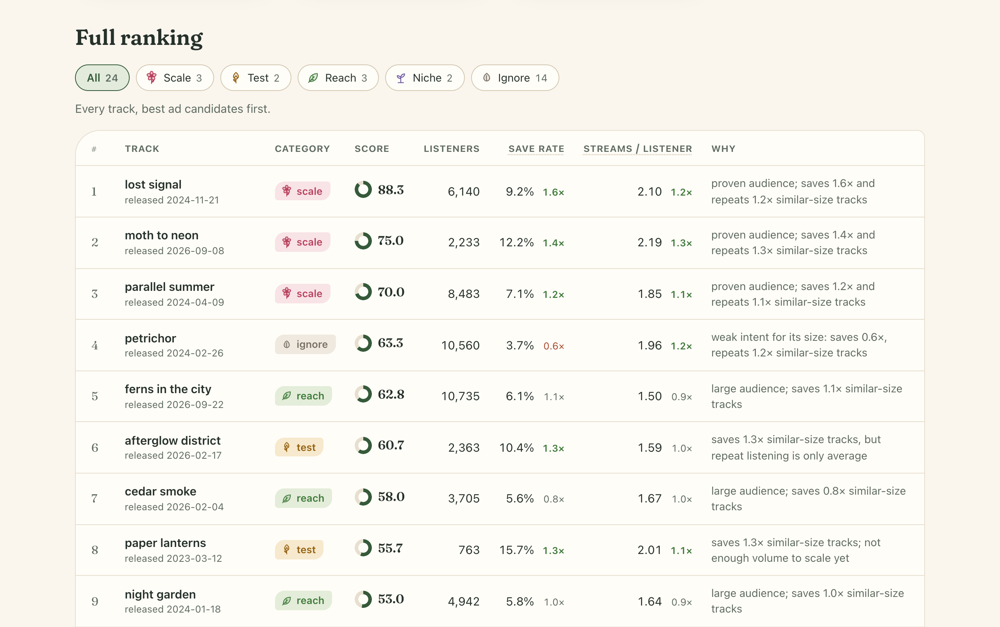
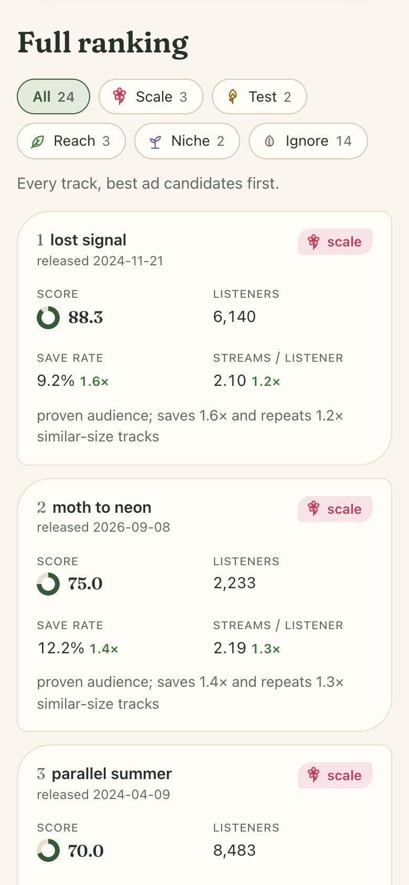

# spotrank

`spotrank` ranks Spotify for Artists song exports and identifies which tracks are better candidates for Meta ads. It comes as a Go CLI and as a web UI where you drop the CSV and get the results.

It reads a CSV export, detects the relevant columns, computes intent metrics such as save rate and streams per listener, and returns a ranked list of tracks with a category and short explanation.



## Try it

`example.csv` is a made-up catalog of 24 tracks, so you can try `spotrank` without your own export:

```bash
go build -o spotrank main.go
./spotrank example.csv
```

Or start the [web UI](#web-ui) and drop `example.csv` onto the page.

## Why

Not every track with many streams is a good ad candidate.

For paid acquisition, especially on Meta, the best tracks are usually the ones that combine:

- enough listener volume
- a high save rate for their audience size
- strong repeat listening
- recent momentum, when release date is available

`spotrank` turns those signals into a deterministic ranking.

## Input

Use a CSV export from Spotify for Artists, preferably from the Songs table. A window of about the last 12 months works well: long enough to have volume, without the release-week spike from existing fans that an all-time export includes.

Required columns:

```text
song / track / title
listeners
streams
saves
```

Optional columns:

```text
playlist adds
release date
```

Column names are detected case-insensitively. Common variants such as `song`, `track`, `Track Name`, `streams`, `saves`, and `release_date` are supported.

## Build

From the project directory:

```bash
go build -o spotrank main.go
```

## Install without sudo

Create a local binary directory:

```bash
mkdir -p ~/bin
```

Build directly into it:

```bash
go build -o ~/bin/spotrank main.go
```

Add `~/bin` to your shell path.

For `zsh`:

```bash
echo 'export PATH="$HOME/bin:$PATH"' >> ~/.zshrc
source ~/.zshrc
```

For `bash`:

```bash
echo 'export PATH="$HOME/bin:$PATH"' >> ~/.bashrc
source ~/.bashrc
```

Verify:

```bash
which spotrank
spotrank -h
```

Now you can run `spotrank` from any directory.

## Usage

Basic ranking:

```bash
spotrank songs.csv
```

Inspect the CSV and detected columns:

```bash
spotrank songs.csv -inspect
```

Show more results:

```bash
spotrank songs.csv -top 10
```

Change the minimum listener threshold:

```bash
spotrank songs.csv -min-listeners 1000
```

Change how many listeners a track needs before it can be `scale` or `reach`:

```bash
spotrank songs.csv -proven 5000
```

Export the full ranking:

```bash
spotrank songs.csv -out ranked.csv
```

## Example output

`spotrank example.csv -top 2`:

```text
Loaded 24 tracks
Ranking mode: meta-ads
Minimum listeners: 500
Proven audience: 2000 listeners

Top 2 ad candidates:

1. lost signal
   Score: 88.3 | Category: scale
   Listeners: 6140 | Streams: 12903 | Saves: 471 | Playlist adds: 96
   Save rate: 9.2% (1.6× similar) | Streams/listener: 2.10 (1.2× similar) | Release: 2024-11-21
   Why: proven audience; saves 1.6× and repeats 1.2× similar-size tracks

2. moth to neon
   Score: 75.0 | Category: scale
   Listeners: 2233 | Streams: 4895 | Saves: 194 | Playlist adds: 78
   Save rate: 12.2% (1.4× similar) | Streams/listener: 2.19 (1.3× similar) | Release: 2026-09-08
   Why: proven audience; saves 1.4× and repeats 1.3× similar-size tracks
```

## Web UI

`web/` contains a browser version written in TypeScript. Drag a CSV anywhere onto the page (or click to choose one) and the results appear right away. The file never leaves your machine: parsing and scoring run in the browser, using a port of the CLI's model (`web/src/rank.ts`) that produces the same ranking and the same exported CSV. Keep it in sync with `main.go` when the scoring changes.

```bash
cd web
npm install
npm run dev
```

The page answers "what should I advertise?" first, then shows everything else:

- **Ready to bloom**: a card for each `scale` track, with how much it saves and repeats compared with similar-size tracks. If nothing qualifies yet, the best `test` tracks are shown instead.
- **Full ranking**: every track, best candidates first. Tabs filter by category and explain what each one means. Hover the save rate to see the raw counts behind it; green multipliers clear the bar for `test`/`scale`, red ones fall below `reach`.
- **Controls**: the `-min-listeners` and `-proven` thresholds, manual column mapping when a column isn't detected, and a ranked CSV download in the same format as `-out`.

Categories are drawn as growth stages: `scale` is in bloom, `test` a bud, `reach` a leaf, `niche` a seedling and `ignore` a dormant seed.



On phones, each row becomes a card:

<p align="center"></p>

### Deploy

```bash
cd web
npm run build
```

This writes a static site (`index.html` plus `assets/`, about 165 KB) to `web/dist/`. Upload it to any static host, at a domain root or in a subfolder: asset paths are relative, so it also works on GitHub Pages under `/spotrank/`. No server is needed.

On hosts that build from the repository (Netlify, Vercel, Cloudflare Pages), use `web` as the base directory, `npm run build` as the build command and `dist` as the output directory.

## Manual column mapping

If your CSV uses unusual column names, pass them explicitly:

```bash
spotrank songs.csv \
  -song "Track Name" \
  -listeners "Unique listeners" \
  -streams "Streams" \
  -saves "Saves"
```

Optional fields can also be mapped:

```bash
spotrank songs.csv \
  -song "Track Name" \
  -listeners "Listeners" \
  -streams "Streams" \
  -saves "Saves" \
  -release-date "Release Date" \
  -playlist-adds "Playlist Adds"
```

## Scoring model

The default ranking is tuned for Meta ads.

Base weights:

```text
listeners              25%
streams                15%
save lift              30%
repeat lift            20%
recency                10%   (only when release date is available)
```

Save rate is `saves / listeners`. If `playlist adds` is available, playlist adds count as saves: `(saves + playlist adds) / listeners`.

### Compared with similar-size tracks

Save rate falls sharply as a track's audience grows. Small tracks are heard almost only by fans (and often pick up saves when someone saves the whole release), while big tracks reach strangers through algorithmic playlists. A 6% save rate is excellent at 10,000 listeners and below average at 800.

So save rate and streams per listener are not judged in absolute terms. Each track is compared with the 6 tracks of the catalog closest to it in listeners (about half above, half below), using their median:

```text
save lift    = save rate / median save rate of similar-size tracks
repeat lift  = streams per listener / median of similar-size tracks
```

A save lift of `1.7×` means the track saves 70% more than tracks with a comparable audience. This adapts automatically to genre, export window and catalog size, without relying on universal benchmarks. It also means categories describe the best tracks of *your* catalog: real campaign results are still the final test.

Scores use percentile ranks rather than raw values. This prevents one very large track from flattening the rest of the catalog.

## Categories

Each track receives a category (the web UI draws each one as a growth stage):

| Category | In the web UI | Meaning |
|---|---|---|
| `scale` | in bloom | proven audience and above-peer intent: put budget behind it |
| `test` | bud | above-peer intent, but not enough volume (or repeat) to scale yet |
| `reach` | leaf | proven audience, roughly average intent for its size |
| `niche` | seedling | small sample, but clearly above similar-size tracks |
| `ignore` | dormant seed | weak or unreliable paid-acquisition signal |

Rules, checked in order:

```text
niche    below -min-listeners, at least 100 listeners, save lift ≥ 1.25, repeat lift ≥ 1.0
ignore   any other track below -min-listeners
scale    at least -proven listeners, save lift ≥ 1.1, repeat lift ≥ 1.0, streams/listener ≥ 1.5
test     save lift ≥ 1.1, repeat lift ≥ 0.95, streams/listener ≥ 1.5
reach    at least -proven listeners, save lift ≥ 0.8
ignore   everything else
```

## Sample size

Two listener thresholds control how much a track's numbers are trusted:

- `-min-listeners` (default 500): below this a track is a low-confidence sample. Its score is multiplied by 0.75 and it can only be `niche` or `ignore`.
- `-proven` (default 2000): a track needs this many listeners to be `scale` or `reach`. Between the two thresholds it can be at most `test`.

At a 5% save rate the uncertainty is about ±1 point with 500 listeners and about ±0.5 with 2,000, so smaller differences between tracks are mostly noise.

```bash
spotrank songs.csv -min-listeners 300 -proven 1000
```

## Export format

When using:

```bash
spotrank songs.csv -out ranked.csv
```

The output CSV includes:

```text
rank
song
score
category
reason
listeners
streams
saves
playlist_adds
save_rate
streams_per_listener
save_lift
repeat_lift
release_date
low_confidence
```

## Notes

`spotrank` does not predict ad performance directly. It ranks tracks by observable listener-intent signals.

Use it to choose what to test first, then validate with real campaign data:

- video retention
- click-through rate
- cost per landing page view
- Spotify listeners
- saves
- streams per listener
- follower growth

The best ad candidate is not always the biggest track. It is usually the track that converts attention into repeat listening and saves.
